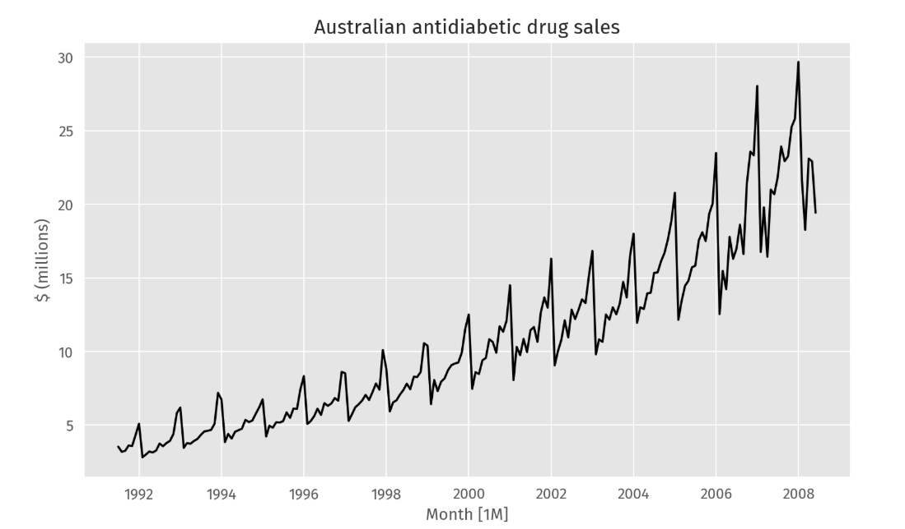

# ՆԵՐԱԾՈՒԹՅՈՒՆ

Ժամանակակից աշխարհում տնտեսական, ֆինանսական, սոցիալական և տեխնոլոգիական գործընթացների մեծ մասը բնութագրվում է ժամանակի ընթացքում փոփոխվող ցուցանիշներով: Ապագա միտումների կանխատեսումը կրիտիկական նշանակություն ունի արդյունավետ որոշումների կայացման, ռիսկերի կառավարման և ռեսուրսների բաշխման համար: Ժամանակային շարքերի վերլուծությունը հնարավորություն է տալիս բացահայտել անցյալի տվյալներում թաքնված օրինաչափությունները, սեզոնայնությունը և միտումները՝ դրանց հիման վրա կատարելով գիտականորեն հիմնավորված կանխատեսումներ։ Այս համատեքստում հատուկ տեղ են զբաղեցնում ARIMA (Autoregressive Integrated Moving Average) մոդելները, որոնք լայնորեն կիրառվում են իրենց ճկունության և վիճակագրական հուսալիության շնորհիվ:

Սույն աշխատանքի նպատակն է ուսումնասիրել ժամանակային շարքերի վերլուծության տեսական հիմքերը և գործնականում կիրառել ARIMA մոդելը՝ իրական տվյալների բազայի հիման վրա կանխատեսումներ իրականացնելու համար:

Աշխատանքում կիրառվել են վիճակագրական տվյալների վերլուծության մեթոդներ, ինչպես նաև Python ծրագրավորման միջավայրում ժամանակային շարքերի մոդելավորման գրադարաններ։

# ԳԼՈՒԽ 1. ԺԱՄԱՆԱԿԱՅԻՆ ՇԱՐՔԵՐԻ ՎԵՐԼՈՒԾՈՒԹՅԱՆ ԵՎ ARIMA ՄՈԴԵԼԻ ՏԵՍԱԿԱՆ ՀԻՄՔԵՐԸ

## 1.1 Ժամանակային շարքերի հիմնական հասկացությունները

Այն ամենը, ինչը հաջորդաբար դիտարկվում է ժամանակի ընթացքում, ժամանակային շարք է: Ժամանակային շարքը բաղկացած է թվային դիտարկումների հաջորդականությունից, ինչպես նաև այդ թվերի գրանցման ժամանակի մասին տեղեկատվությունից:

Ժամանակային շարքերը նկարագրելիս հաճախ օգտագործում ենք այնպիսի եզրույթներ, ինչպիսիք են «միտումը», «սեզոնայնությունը» և «ցիկլը»։

* **Միտում (Trend):** Միտում գոյություն ունի, երբ տվյալներում առկա է երկարաժամկետ աճ կամ նվազում։ Այն պարտադիր չէ, որ լինի գծային։ Երբեմն միտումը բնութագրվում է որպես «ուղղությունը փոխող», երբ այն կարող է աճող միտումից անցնել նվազող միտումի։ Նկար 1-ում պատկերված հակադիաբետիկ դեղամիջոցների վաճառքի տվյալներում առկա է միտում։
* **Սեզոնայնություն (Seasonality):** Սեզոնային օրինաչափությունն առաջանում է, երբ ժամանակային շարքի վրա ազդում են սեզոնային գործոններ, ինչպիսին են տարվա եղանակը, շաբաթվա օրը կամ օրվա ժամը։ Սեզոնայնությունն միշտ ունի ֆիքսված և հայտնի պարբերություն։ Հակադիաբետիկ դեղամիջոցների ամսական վաճառքը (Նկար 1) ցույց է տալիս սեզոնայնություն, որը մասամբ պայմանավորված է օրացուցային տարվա վերջում դեղերի արժեքի փոփոխությամբ։ Նկատենք, որ մեկ շարքը կարող է ունենալ մեկից ավելի սեզոնային օրինաչափություն։
* **Ցիկլ (Cycle):** Ցիկլն առաջանում է, երբ տվյալներում դրսևորվում են աճեր և անկումներ, որոնք չունեն ֆիքսված հաճախականություն։ Այս տատանումները սովորաբար պայմանավորված են տնտեսական պայմաններով և հաճախ կապված են «բիզնես ցիկլի» հետ, և տևողությունը սովորաբար առնվազն 2 տարի է։

---

**Նկար 1**  

Հեշտ է շփոթել ցիկլիկ վարքագիծը սեզոնային վարքագծի հետ, սակայն դրանք իրականում բավականին տարբեր են։ Եթե տատանումները չունեն ֆիքսված հաճախականություն, ապա դրանք ցիկլիկ են. եթե հաճախականությունն անփոփոխ է և կապված է օրացույցի որևէ առանձնահատկության հետ, ապա օրինաչափությունը սեզոնային է։ Ընդհանուր առմամբ, ցիկլերի միջին տևողությունն ավելի երկար է, քան սեզոնային օրինաչափության տևողությունը։

Բազմաթիվ ժամանակային շարքեր ներառում են միտում, ցիկլեր և սեզոնայնություն։ Կանխատեսման մեթոդ ընտրելիս անհրաժեշտ է նախ բացահայտել տվյալների մեջ առկա օրինաչափությունները, այնուհետև ընտրել այնպիսի մեթոդ, որը կարող է պատշաճ կերպով արտացոլել այդ օրինաչափությունները։

Ժամանակային շարքի հետաձգված արժեքները (lagged values) նույն շարքի նախորդ պահերի դիտարկումներն են։ Օրինակ՝ ամսական տվյալների դեպքում նախորդ ամսվա արժեքն է, իսկ անցյալ տարվա նույն ամսվա արժեքը՝ համապատասխան լեգով։ Այսպիսի արժեքները օգտագործվում են ինչպես ավտոկոռելիացիան հաշվարկելիս, այնպես էլ ավտոռեգրեսիոն մոդելներում որպես կանխատեսիչներ։

## 1.2 Ժամանակային շարքի դեկոմպոզիցիա

Ժամանակային շարքերի տվյալները կարող են դրսևորել զանազան օրինաչափություններ, և հաճախ օգտակար է լինում ժամանակային շարքը բաժանել մի քանի բաղադրիչների, որոնցից յուրաքանչյուրը ներկայացնում է դրանց հիմքում ընկած օրինաչափության որևէ կատեգորիա:

Երբ ժամանակային շարքը բաժանում ենք բաղադրիչների, սովորաբար միավորում ենք միտումն ու ցիկլը մեկ՝ **միտում-ցիկլային բաղադրիչի** մեջ (պարզության համար հաճախ կանվանենք միտում): Այսպիսով, կարող ենք համարել, որ ժամանակային շարքը բաղկացած է երեք հիմնական բաղադրիչից՝ **միտում-ցիկլային բաղադրիչից**, **սեզոնային բաղադրիչից** և **մնացորդային բաղադրիչից** (պարունակում է ժամանակային շարքում առկա ցանկացած այլ պատահական կամ անկանոն տատանում): 

Ժամանակային շարքերի դասական դեկոմպոզիցիայի առաջին քայլը **շարժվող միջինի մեթոդի** օգտագործումն է՝ միտում-ցիկլը գնահատելու համար։ $m$ կարգի շարժվող միջինը գրվում է հետևյալ կերպ.

$$\hat{T}_t = \frac{1}{m} \sum_{j=-k}^{k} y_{t+j}$$

որտեղ $m = 2k + 1$: Այսինքն՝ $t$ պահին միտում-ցիկլի գնահատականը ստացվում է $t-k$-ից մինչև $t+k$ ժամանակահատվածի միջակայքում գտնվող ժամանակային շարքի արժեքների միջինացմամբ: Ժամանակի առումով մոտ գտնվող դիտարկումները հավանաբար մոտ են նաև իրենց արժեքներով, հետևաբար, միջինացումը վերացնում է տվյալների պատահականության մի մասը՝ թողնելով միտում-ցիկլային հարթ բաղադրիչը: Սա կոչվում է $m$ կարգի շարժվող միջին (կնշանակենք $m$-MA): 

Շարժվող միջինները սովորաբար կենտ կարգի են: Սա արվում է այն նպատակով, որպեսզի դրանք լինեն սիմետրիկ. $m$ կարգի շարժվող միջինում միջինացվում են մեջտեղի դիտարկումը և $k$ հատ դիտարկում երկու կողմերից: Սակայն եթե $m$-ը լինի զույգ, այն այլևս սիմետրիկ չի լինի:

Շարժվող միջինը կարելի է կիրառել մեկ այլ շարժվող միջինի նկատմամբ: Դա անելու պատճառներից մեկը զույգ կարգի շարժվող միջինը սիմետրիկ դարձնելն է: $2 \times m$-MA նշանակումը ցույց է տալիս, որ ժամանակային շարքի վրա կիրառվել է $m$-կարգի շարժվող միջին, որին հաջորդել է 2-կարգի շարժվող միջինը: Երբ զույգ կարգի MA-ին հաջորդում է մեկ այլ MA, այն կոչվում է *«կենտրոնացված շարժվող միջին»*: Սա այն պատճառով է, որ արդյունքներն այժմ սիմետրիկ են: Ընդհանուր առմամբ, զույգ կարգի MA-ին պետք է հաջորդի զույգ կարգի MA, որպեսզի այն դառնա սիմետրիկ, իսկ կենտ կարգի MA-ին պետք է հաջորդի կենտ կարգի MA: 

Շարժվող միջինների համադրությունները հանգեցնում են **կշռված շարժվող միջինների**: Կշռված $m$-MA-ն կարող է գրվել որպես

$$\hat{T}_t = \sum_{j=-k}^{k} a_j y_{t+j}$$

որտեղ $m = 2k + 1$, իսկ կշիռները տրված են $(a_{-k}, \dots, a_k)$ տեսքով: Կարևոր է, որ բոլոր կշիռների գումարը հավասար լինի մեկի ($\sum a_j = 1$), և որ դրանք լինեն սիմետրիկ, այսինքն՝ $a_j = a_{-j}$: Պարզ $m$-MA-ն մասնավոր դեպք է, որտեղ բոլոր կշիռները հավասար են $\frac{1}{m}$-ի: 

Դասական դեկոմպոզիցիայի երկու ձև կա՝ **գումարային** և **բազմապատիկ**:

**Գումարային դեկոմպոզիցիան**
$m$ սեզոնային պարբերություն ունեցող ժամանակային շարքի համար (օրինակ՝ $m=4$ եեռամսյակային տվյալների դեպքում, $m=12$՝ ամսական և այլն) կատարվում է հետևյալ քայլերով․

* **Քայլ 1.** Եթե $m$-ը զույգ թիվ է, հաշվարկել միտում-ցիկլային բաղադրիչը՝ $\hat{T}_t$-ն, օգտագործելով $2 \times m$ շարժվող միջին, իսկ եթե կենտ է՝ $m$ շարժվող միջին։
* **Քայլ 2.** Հաշվարկել առանց միտումի շարքը՝ $y_t - \hat{T}_t$:
* **Քայլ 3.** Յուրաքանչյուր սեզոնի համար սեզոնային բաղադրիչը գնահատելու նպատակով հաշվել տվյալ սեզոնի առանց միտումի արժեքների միջինը: Այնուհետև այս սեզոնային բաղադրիչի արժեքները կարգավորել՝ ապահովելու համար, որ դրանց գումարը հավասար լինի զրոյի: Սեզոնային բաղադրիչը ($\hat{S}_t$) ստացվում է այս ամսական արժեքները միմյանց կցելով, ապա տվյալների յուրաքանչյուր տարվա համար այդ հաջորդականությունը կրկնօրինակելով։
* **Քայլ 4.** Հաշվել մնացորդային բաղադրիչը՝ հանելով գնահատված սեզոնային և միտում-ցիկլային բաղադրիչները՝ $\hat{R}_t = y_t - \hat{T}_t - \hat{S}_t$:

Բազմապատիկ դեկոմպոզիցիան նման է գումարայինին, բացառությամբ այն բանի, որ հանումները փոխարինվում են բաժանումներով.

* **Քայլ 1.** Եթե $m$-ը զույգ թիվ է, հաշվարկել միտում-ցիկլային բաղադրիչը՝ $\hat{T}_t$-ն, օգտագործելով $2 \times m$ շարժվող միջին, իսկ եթե կենտ է՝ $m$ շարժվող միջին։
* **Քայլ 2.** Հաշվարկել առանց միտումի շարքը՝ $y_t / \hat{T}_t$:
* **Քայլ 3.** Յուրաքանչյուր սեզոնի համար սեզոնային բաղադրիչը գնահատելու նպատակով հաշվել տվյալ սեզոնի առանց միտումի արժեքների միջինը: Այս սեզոնային բաղադրիչի արժեքները կարգավորել այնպես, որ դրանց գումարը հավասար լինի $m$-ի (կամ միջինը լինի 1): Սեզոնային բաղադրիչը ($\hat{S}_t$) ստացվում է այս արժեքները միմյանց կցելով և կրկնօրինակելով յուրաքանչյուր տարվա համար։
* **Քայլ 4.** Հաշվել մնացորդային բաղադրիչը՝ բաժանելով գնահատված սեզոնային և միտում-ցիկլային բաղադրիչների վրա՝ $\hat{R}_t = y_t / (\hat{T}_t \hat{S}_t)$:

